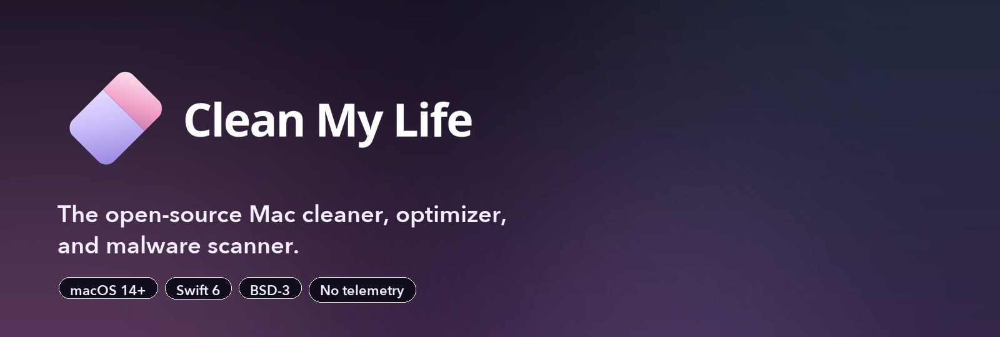
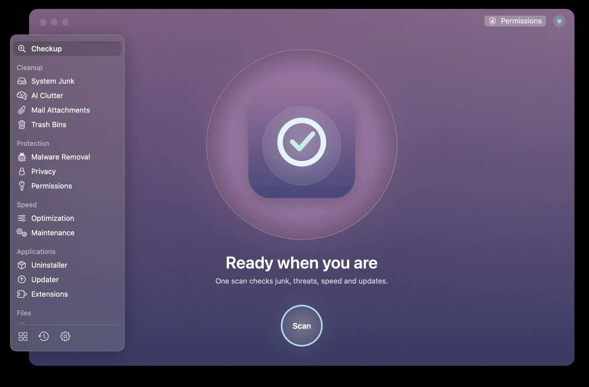
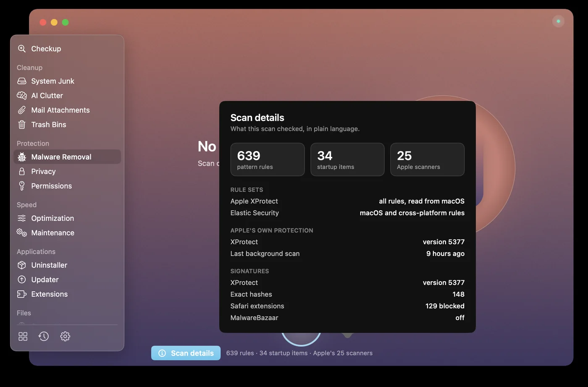
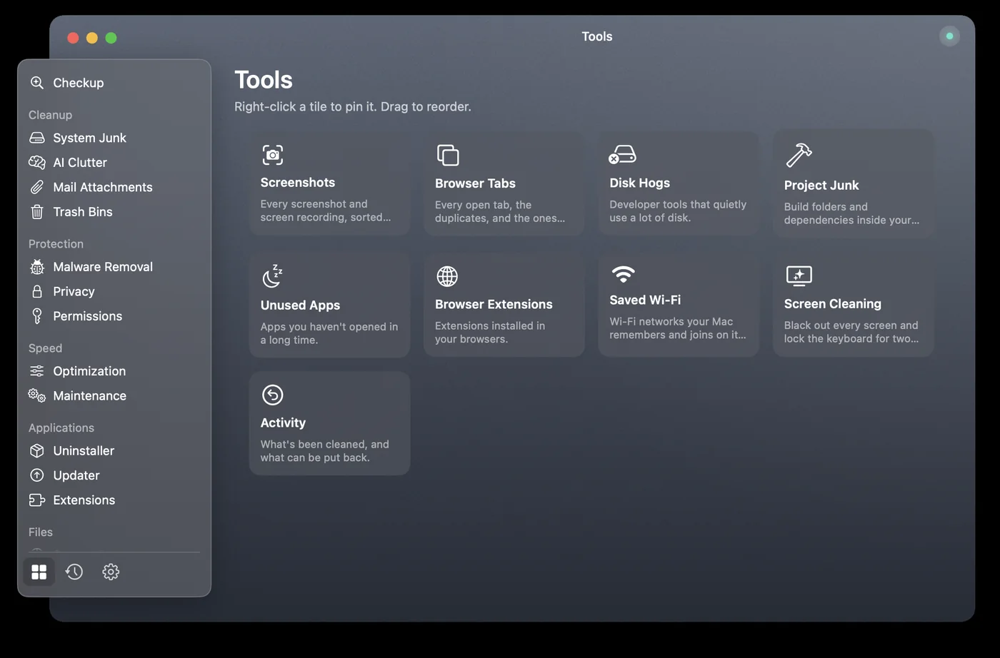

<div align="center">




[](https://github.com/itchyparrot53/clean-my-life/actions/workflows/ci.yml)

</div>

> [!IMPORTANT]
> 0.1.0 is a public beta. Back up anything important and pin a release tag. The
> build is ad-hoc signed, not notarized; the [install](#install) section has the
> one command that clears Gatekeeper's first-launch prompt.

**Clean My Life** is a free, open-source Mac cleaner, optimizer and malware
scanner: 25 tools in one native SwiftUI app, with no subscription, account or
telemetry.

Built with **Opus 5.5** and **DeepSeek 4.1 Flash 1017**. Inspired by CleanMyMac,
but not affiliated with MacPaw, CleanMyMac or Apple.

## Screens

<table>
<tr>
<td width="33%"></td>
<td width="33%"></td>
<td width="33%"></td>
</tr>
<tr>
<td align="center"><sub>Checkup</sub></td>
<td align="center"><sub>Scan details</sub></td>
<td align="center"><sub>Tools</sub></td>
</tr>
</table>

## What it does

- **Cleanup.** System Junk, AI Clutter, Downloads, Similar Photos, Screenshots,
  Mail Attachments, Trash Bins, Project Junk, Disk Hogs and Activity history.
- **Protection.** Malware Removal, Privacy, Browser Extensions, Saved Wi-Fi,
  Permissions and Browser Tabs.
- **Speed and apps.** Login items, maintenance tasks, Uninstaller, Unused Apps,
  Extensions, Updater.
- **Files.** Space Map, Large & Old Files, Duplicates (with APFS clones) and the
  Shredder.
- **Menu bar.** CPU, memory, disk, battery, network and the last scan.

Every deletion is trash-first and review-first. Only exact malware signatures
are pre-selected.

## Malware scan

The scanner evaluates Apple's full XProtect rule set and Elastic Security's
macOS rules through YARA-X, then checks the places malware restarts from:

- launch agents, background items, login items, cron, shell startup files,
  periodic scripts, login hooks and browser policies;
- code trust: unsigned, ad-hoc, revoked, not notarized, quarantined, hidden;
- every Chromium profile and Firefox, with store verdicts and permissions;
- Deep mode opens disk images, installers and zips read-only, plus USB drives.

It is **not an antivirus**: no behavioural monitoring, no cloud sandbox, no
zero-day promise. The app says so and never pre-selects a guess. Full detail:
[docs/MALWARE.md](docs/MALWARE.md).

## Install

```bash
# Download the DMG from Releases, then:
xattr -dr com.apple.quarantine "/Applications/Clean My Life.app"
open "/Applications/Clean My Life.app"
```

Or build it:

```bash
git clone https://github.com/itchyparrot53/clean-my-life.git
cd clean-my-life
brew install yara-x          # optional: enables pattern rules
swift build
swift test
bash scripts/build-dmg.sh --app-only
```

The app needs **Full Disk Access** for Mail, Privacy and parts of the malware
scan: System Settings → Privacy & Security → Full Disk Access → add Clean My
Life → restart it.

The cask is in the repo until a tap is published:

```bash
brew install --cask ./Casks/clean-my-life.rb
```

## Privacy

- No telemetry, analytics, crash reporter or account.
- Scan results and file lists stay local.
- The only optional network call is the MalwareBazaar hash feed, after you add
  your own free key.
- **One Apple check is disclosed.** If a MalwareBazaar hash matches a signed
  file, macOS asks Apple whether its signing certificate was revoked, the same
  OCSP check Gatekeeper makes. That request is about the certificate, not your
  files.

### Verify no telemetry yourself

The repository ships a checker that inspects the built bundle, not just the source:

```bash
bash scripts/check-network-surface.sh "/Applications/Clean My Life.app"
```

It covers the main app and every bundled helper: `Sparkle.framework`, `Autoupdate`, `Updater.app`, `Downloader.xpc` and `Installer.xpc`.

You can also watch the live process. This snapshot selects PIDs by executable paths inside the chosen app bundle, so an unrelated Installer or Updater is excluded:

```bash
(
CML_APP=$(cd "/Applications/Clean My Life.app" && pwd -P) || exit 1
CML_PIDS=$(ps -ww -axo pid=,comm= | awk -v bundle="$CML_APP/" '
  { pid=$1; sub(/^[[:space:]]*[0-9]+[[:space:]]+/, "")
    if (index($0, bundle) == 1) print pid }' | paste -sd, -)
if [ -n "$CML_PIDS" ]; then
  ps -p "$CML_PIDS" -o pid=,comm=
  lsof -nP -a -p "$CML_PIDS" -i
else
  echo "No running executables from this Clean My Life bundle"
fi
)
```

An idle app opens no sockets.

## Keyboard shortcuts

| Shortcut | Action |
| --- | --- |
| `⌘R` | Scan or run |
| `⌘⌫` | Clean or remove |
| `⌘Z` | Undo the last clean |
| `Space` | Quick Look |
| `⌘F` | Search a review list |
| `Esc` | Back or close |
| `⌘1`–`⌘9` | Sidebar |
| `⌘,` | Settings |

## Documentation

[Malware engine](docs/MALWARE.md) · [Motion audit](docs/MOTION_AUDIT.md) ·
[Localization](docs/LOCALIZATION.md) ·
[Releasing](docs/RELEASING.md) · [Changelog](CHANGELOG.md)

## Support and contributing

Questions go to [Discussions](https://github.com/itchyparrot53/clean-my-life/discussions);
bugs to [Issues](https://github.com/itchyparrot53/clean-my-life/issues);
vulnerabilities through [SECURITY.md](SECURITY.md). Read
[CONTRIBUTING.md](CONTRIBUTING.md) and [CODE_OF_CONDUCT.md](CODE_OF_CONDUCT.md)
before a pull request.

## Licence

BSD-3-Clause. See [LICENSE](LICENSE) and [NOTICE](NOTICE). Clean My Life is an
independent fork; it is not affiliated with Apple or the upstream maintainers.

Third-party notices: YARA-X (BSD-3-Clause), Elastic protections-artifacts
(Elastic License 2.0), Apple XProtect (read from macOS, not redistributed).
