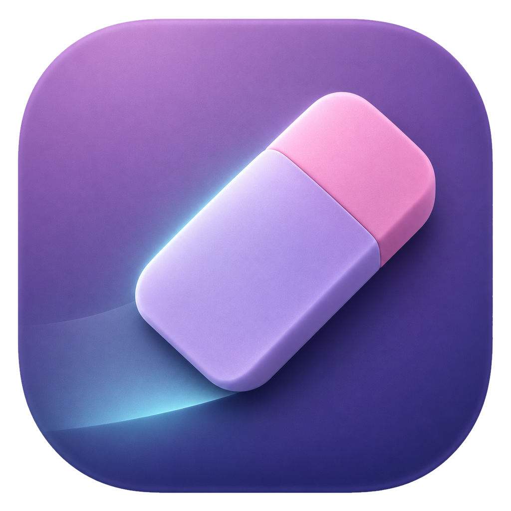

  

<h1 align="center">Supporters</h1>

  The people who keep Clean My Life free, open and maintained.

Clean My Life is free and stays free. Nothing is locked behind a membership:
support funds the work, it does not buy access. Everyone listed here chose to
be listed, and their names also appear in the app under **Settings > About >
Supporters**.

## Teams

*No team members yet.*

## Power Users

*No Power User members yet.*

## Regulars

*No members yet. Join the [discussions](https://github.com/itchyparrot53/clean-my-life/discussions) to help shape the next release.*

## How support is used

- Keeping the app free and the site online.
- Paying for a Developer ID certificate so releases can be notarized.
- Buying time for tests on older Macs and macOS versions.

There is no sponsorship tier, no paid build and no advertising inside the app.
